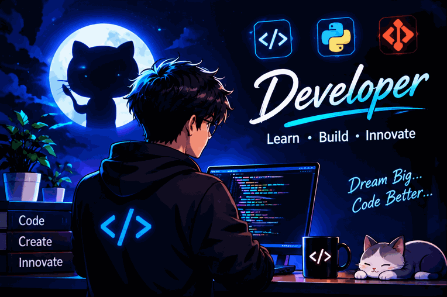

  <h1>Yuvraj Vaidya</h1> <h3>AI &amp; Data Science Undergraduate &nbsp;|&nbsp; Python Developer &nbsp;|&nbsp; Data Enthusiast</h3> 

  

   

  <h2 align="center">About Me</h2> <ul> <li>🎓 Pursuing <b>B.Tech in Artificial Intelligence &amp; Data Science</b> at P.R. Pote Patil College of Engineering, Amravati (2023 – 2027)</li> <li>📊 I turn messy data into clear, interactive insights with Python, Pandas and Power BI</li> <li>🏥 Currently building <b>ResQ</b>, an intelligent hospital selection and routing system</li> <li>🌱 Learning Machine Learning, Data Structures &amp; Algorithms and applied AI tooling</li> <li>🏆 3rd place winner for an IPL-themed Power BI dashboard</li> <li>🔌 Hands-on with Embedded Systems / IoT using Arduino, and I enjoy video editing</li> <li>🤝 Open to internships, collaborations and beginner-friendly open source</li> </ul>  <h2 align="center">Tech Stack</h2> 
  
 <table align="center" width="100%"> <thead> <tr><th align="left">Area</th><th align="left">Skills</th></tr> </thead> <tbody> <tr><td>💻 Languages</td><td>Python, C, C++</td></tr> <tr><td>🤖 ML &amp; AI</td><td>Foundational ML concepts, prompt engineering, applied AI tooling</td></tr> <tr><td>📊 Data &amp; Analytics</td><td>Pandas, NumPy, Power BI, data cleaning and visualization</td></tr> <tr><td>🧠 CS Fundamentals</td><td>Data structures and algorithms, structured problem-solving</td></tr> <tr><td>🔧 Tools</td><td>Git / GitHub, MS Office, Power BI</td></tr> <tr><td>🔌 Hardware</td><td>Embedded Systems / IoT, Arduino sensor interfacing</td></tr> </tbody> </table>  <h2 align="center">Featured Projects</h2> <table align="center" width="100%"> <thead> <tr><th align="left">Project</th><th align="left">What it does</th><th align="left">Tech</th></tr> </thead> <tbody> <tr> <td>🏥 <b>ResQ</b> Hospital Selection &amp; Routing 2025 – 2026</td> <td>Decision-support system that ranks and routes patients to hospitals using rule-based logic on distance, availability and urgency.</td> <td>Python, Git</td> </tr> <tr> <td>🚦 <b>AI Traffic Management</b> 2024 – 2025</td> <td>Analyzes time-series traffic data to find congestion patterns and proposes smarter signal-timing strategies.</td> <td>Python, Pandas</td> </tr> <tr> <td>🏏 <b>IPL Power BI Dashboard</b> 🥉 2023 – 2024</td> <td>End-to-end pipeline from raw match data to an interactive dashboard with custom KPIs, charts and filters. Awarded 3rd place.</td> <td>Pandas, Power BI</td> </tr> </tbody> </table> 
<a href="https://github.com/vaidyayuvraj1-prog?tab=repositories">See all my repositories →</a>
  <h2 align="center">GitHub Activity</h2> 
  
 
  
 
  
  <h2 align="center">Let's Connect</h2> 
    
 
<i>Code. Learn. Build. Repeat.</i>
 
